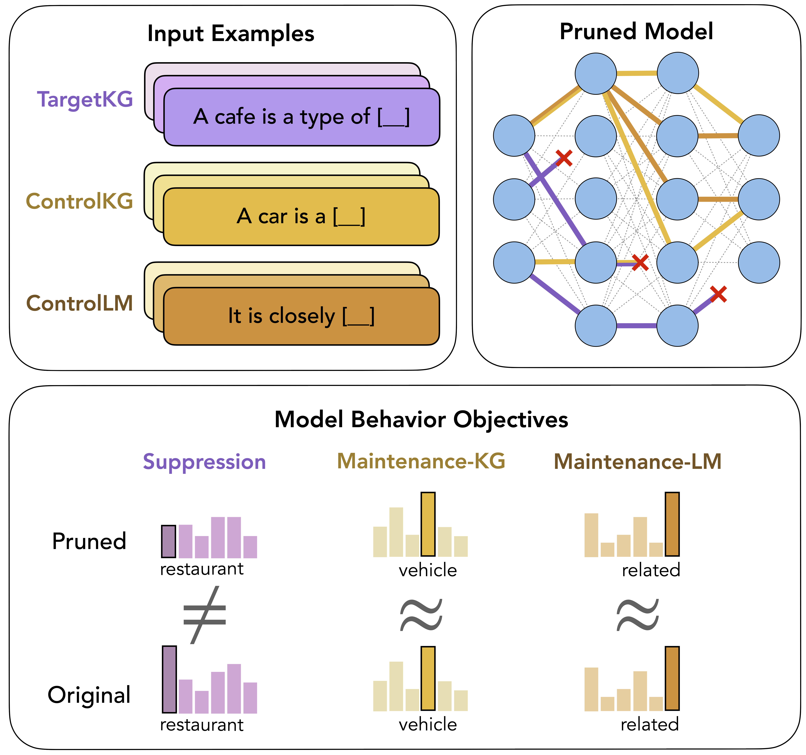

# Discovering Knowledge-Critical Subnetworks in Pretrained Language Models

This codebase is the implementation of the EMNLP 2024 paper *Discovering Knowledge-Critical Subnetworks in Pretrained Language Models*. 

**Paper:** [https://arxiv.org/abs/2310.03084](https://arxiv.org/abs/2310.03084).

<p align="center">
    
    <br>
    <em>Figure 1: Identifying knowledge-critical subnetworks.</em>
</p>

> Knowledge-critical subnetworks are necessary for expressing target knowledge triplets (TargetKG) in LMs. When removed, the remaining model no longer expresses the specific triplets, but maintains its ability to express other relational knowledge (ControlKG) and its language modeling abilities (ControlLM)

## Table of Contents

* [Abstract](#abstract)
* [Setup](#setup)
    * [Requirements](#requirements)
    * [Data](#data)
* [Repository Structure](#repository-structure)
* [Usage](#usage)
    * [Mask training & testing](#mask-training--testing)
    * [Downstream task finetuning](#downstream-task-finetuning)
    * [Structural analysis](#structural-analysis)
* [Bugs or questions](#bugs-or-questions)
* [Citation](#citation)

## Abstract

Pretrained language models (LMs) encode implicit representations of knowledge in their parameters. However, localizing these representations and disentangling them from each other remains an open problem. In this work, we investigate whether pretrained language models contain various knowledge-critical subnetworks: particular sparse computational subgraphs that can, if removed, precisely suppress specific knowledge the model has memorized. We propose a multi-objective differentiable masking scheme that can be applied to both weights and neurons to discover such subnetworks and show that we can use them to precisely remove specific knowledge from models while minimizing adverse effects on the behavior of the original model. We demonstrate our method on multiple GPT2 variants, uncovering highly sparse subnetworks (98%+ sparsity) that are critical for expressing specific collections of relational knowledge. When these subnetworks are removed, the remaining network maintains most of its initial abilities but struggles to represent the suppressed knowledge.

## Setup

### Requirements

To execute our code, you’ll need Python 3.10. The method was originally evaluated with 3.8, we now provide a Python 3.10 release with a higher version of the `transformers` package to make it easier for future users to integrate new model architectures. Therefore you may see minor differences with the original paper results. You can install the dependencies with:

```shell
conda create --name subnetvenv python=3.10
conda activate subnetvenv
pip install -r requirements.txt
```

You will then need to download the codebase as a package at the root of the repository:

```shell
cd know-subnet
pip install -e .
```

Our code uses `wandb` to log the experiment metrics. So make sure to login with your API key or have the key in your OS environment. Set those in `know_subnet/downstream_task/config/main/main.yaml` and `know_subnet/downstream_task/config/base.yaml` as well.

### Data

Thanks to its small size, the data is directly uploaded to this repository in the `data` folder.


## Repository Structure

The repository is structured the following way, where caching and logging will happen in `logs`.

```shell
.
├── know_subnet
│   │ # ---------------- folders ----------------
│   ├── configs # stores configs for mask training (subnet_train.py)
│   ├── data # stores datasets and dataloaders
│   │   ├── wordnet
│   │   ├── conceptnet_lama
│   │   ├── csqa
│   │   ├── wordnet_dataloader.py
│   │   ├── conceptnet_dataloader.py
│   │   ├── csqa_dataloader.py
│   │   └── wikitext_dataloader.py
│   ├── downstream_task # stores files for finetuning remaining parameters on downstream task
│   │   ├── config
│   │   ├── load_checkpoint.py
│   │   ├── logger.py
│   │   ├── main.py
│   │   ├── runner.py
│   │   └── trainer.py
│   ├── figs # stores plots and other figures
│   ├── lm # stores all utils for masking
│   │   ├── gpt2.py
│   │   ├── lm_mixins.py
│   │   ├── lm_utils.py
│   │   └── mask.py
│   ├── logs # folder for caching checkpoints and results
│   ├── scripts
│   │ # ---------------- files ----------------
│   ├── args.py # args file for mask training (subnet_train.py)
│   ├── constants.py # saves constants like paths and hyperparameters
│   ├── metrics.py # metrics for evaluating masks
│   ├── subnet_train.py # mask training script
│   ├── subnet_train_utils.py # mask training script helper
│   ├── subnet_test.py # mask testing script
│   ├── subnet_gather_results.py # script to gather mask testing results
│   ├── analysis_subnet_structure.ipynb
│   ├── utils.py # utility functions
│   └── vis.py # visualization functions
├── LICENSE
├── README.md
├── requirements.txt
└── setup.py
```


## Usage

### Mask training & testing

The primary files needed to run the experiments are `subnet_train.py` and `subnet_test.py`, and `subnet_gather_results.py` to gather the experiments. A demonstration on how to run them quickly is in the following bash file. For more information about the arguments, please refer to `args.py`.

```shell
bash scripts/local_subnet_example.sh
```

Here are the scripts for the experiments:

1. For results on **weights** masking & random baseline:
```shell
bash scripts/local_subnet_weight.sh
```

2. For results on **neuron** masking & random baseline:
```shell
bash scripts/local_subnet_neuron.sh
```

3. For results on **weights** masking & random baseline **at scale** (`gpt2-medium`, `gpt2-large`, `gpt2-xl`):
```shell
bash scripts/local_subnet_scale.sh
```

3. For **ablation** results:
```shell
bash scripts/local_subnet_ablation.sh
```

4. For seed-based & kg-based **composition** results:
```shell
bash scripts/local_subnet_composition.sh
```


### Downstream task finetuning

For the downstream task finetuning experiments you would need to (1) train a mask for the TargetKG and (2) finetune the model where that mask is removed with a specific finetuning style.

For step (1) CSQA mask training: use the following scripts. Note the experiment folder that is created under `know_subnet/logs`. That directory will be the `checkpoint_dir` used for downstream finetuning.

```shell
bash scripts/local_subnet_csqa_weight.sh
bash scripts/local_subnet_csqa_neuron.sh
```

For step (2) we run the downstream QA task on the checkpoint produced by step (1) and set all the parameters belonging to the mask to 0. Each script loads the mask-training run's `checkpoint_dir`, removes the mask, and then finetunes/evaluates on the QA dataset splits (head-only vs full-model finetuning). The downstream CSQA task uses the QA-format `.jsonl` splits under `data/csqa/` rather than the KG-style `*_best_format.json` files used during mask training.

```shell
bash scripts/local_downstream_csqa_head.sh
bash scripts/local_downstream_csqa_full.sh
```

If you want to implement something different, you can also run directly with Hydra overrides, for example:
```shell
python -m know_subnet.downstream_task.main main=main mask=none
```

### Structural analysis

To do the structural analysis make sure to first train the masks you want as stated in "Mask training & testing" above.
We then plot the results in `analysis_subnet_structure.ipynb`. Make sure to change the `project_name` variable to the one with the masks you want.

## Bugs or questions

Note that this codebase is purely for the purpose of research and scientific experiments. We expect unknown bugs or issues caused by different package versions. If you encounter any problems when using the code or want to report a bug, you can open an issue. Please try to specify the problem with details so we can help you better and quicker! If you have any questions related to the code or the paper, feel free to email the corresponding authors.

## Related Codebases

This work was built on top of prior work and open-sourced code, which we are very grateful for. We particularly thank the contributors of [stevenxcao/subnetwork-probing](https://github.com/stevenxcao/subnetwork-probing) and [RobertCsordas/modules](https://github.com/RobertCsordas/modules) as majority of the mask modules were borrowed from them. We also highly suggest looking at more generic masking code from [mlepori1/NeuroSurgeon](https://github.com/mlepori1/NeuroSurgeon) if you are interested in trying different types of model pruning with our approach.

## Citation

If you use our method in your work, please cite our paper:

```bibtex
@inproceedings{bayazit-etal-2024-discovering,
    title = "Discovering Knowledge-Critical Subnetworks in Pretrained Language Models",
    author = "Bayazit, Deniz  and
      Foroutan, Negar  and
      Chen, Zeming  and
      Weiss, Gail  and
      Bosselut, Antoine",
    booktitle = "Proceedings of the 2024 Conference on Empirical Methods in Natural Language Processing",
    year = "2024",
    publisher = "Association for Computational Linguistics",
    url = "https://aclanthology.org/2024.emnlp-main.376/",
    doi = "10.18653/v1/2024.emnlp-main.376"
}
```
